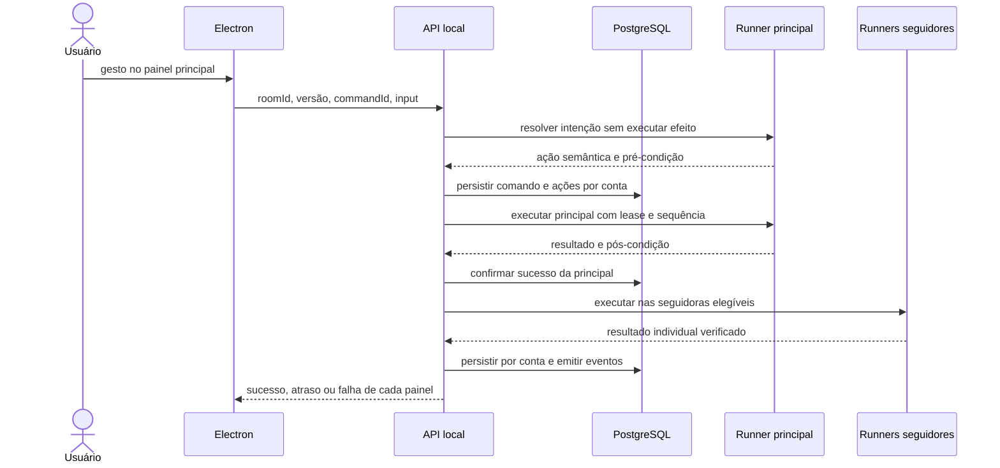
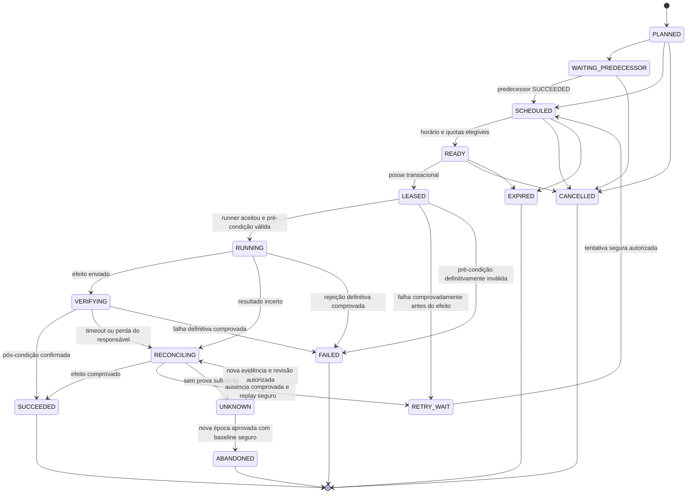

# 1. Arquitetura e fluxos

## 1.1 Objetivo, vocabulário e limites

O MultiSession Manager administra contas legítimas em **sites selecionados pelo cliente após a instalação**. O objetivo é manter até 500 contas cadastradas e seus estados autenticados recuperáveis, com uma a quatro contas visíveis, executando trabalho em um conjunto limitado de sessões ativas. Um núcleo genérico oferece navegação, sessões, proxy e interação. Receitas configuráveis acrescentam automação de interface; integrações opcionais oferecem conhecimento específico do site, como login automático, detecção de ban e pós-condições de negócio. Não é necessário escolher um site para iniciar o desenvolvimento.

| Conceito | Significado | Limite inicial proposto |
| --- | --- | --- |
| Conta cadastrada | Registro de login, grupo, credenciais e política | Conforme plano, até 500 |
| Sessão persistida | Snapshot autenticado criptografado, possivelmente expirado no servidor | Até uma versão atual por conta, com histórico limitado |
| Sessão verificada | Autenticação confirmada no site em horário conhecido | Indicador com validade, não garantia contínua |
| Contexto ativo | `BrowserContext` carregado com uma conta | Até 8 no perfil padrão: 4 visíveis + 4 de fundo |
| Navegador ativo | Instância Chromium, com árvore de subprocessos | Um por grupo ativo; nunca compartilhado entre grupos |
| Job em execução | Unidade lógica consumindo um slot | Uma ação por conta; limites globais e de grupo |
| Worker de grupo | Processo/container responsável por um grupo ativo | Quantidade limitada pelo orçamento de recursos |

“500 contas simultâneas” significa 500 contas administráveis e agendáveis. Manter 500 páginas ativas, WebSockets ou presença online contínua é um requisito diferente e exige dimensionamento próprio. Um snapshot não impede expiração de cookies, encerramento de sessão pelo servidor ou proibição de múltiplos logins.

Premissas para a primeira versão:

1. Uma instalação desktop por workspace/tenant; colaboração entre dispositivos exige serviço coordenador remoto adicional.
2. Perfis de site configuráveis pelo cliente, com núcleo genérico versionado e integrações específicas opcionais. As salas de espelhamento e receitas são limitadas a um mesmo perfil/fluxo compatível por padrão.
3. Docker Engine/Compose disponível no Linux, ou runtime compatível no Windows/macOS. O instalador detecta a dependência e conduz a configuração.
4. O backend local e os workers rodam em containers. O Electron e o supervisor de containers rodam no host.
5. Contas inativas não mantêm páginas abertas. Abertura sob demanda e restauração de sessão têm latência visível.
6. Nenhuma operação pressupõe que um clique, um HTTP 200 ou o recebimento de um job signifique sucesso de negócio.
7. Requisitos de “tudo espelhado”, “máquinas completamente diferentes” e “sem navegador” são traduzidos em capacidades verificáveis; as limitações estão nas seções correspondentes.

## 1.2 Stack e organização de responsabilidades

**Escolha:** Electron + React + TypeScript + Tailwind; Fastify em um monólito modular; PostgreSQL; Redis + BullMQ; Playwright/Chromium; libsodium; Docker Compose. Um monorepo compartilha contratos tipados, sem compartilhar acesso direto ao banco com a interface.

Fastify permite organizar plugins por domínio e validar entrada/saída com schemas. Os schemas são código confiável da aplicação; usuários e sites não podem fornecer schemas compiláveis. Referência: [validação e serialização do Fastify](https://fastify.dev/docs/latest/Reference/Validation-and-Serialization/).

Não começar com microserviços por entidade. Separar processos apenas onde existe motivo operacional: UI, API, agendador, workers isolados e plano remoto de licenciamento. O mesmo código de domínio pode atender APIs e consumidores, evitando regras divergentes.

```text
HOST DO USUÁRIO
┌──────────────────────────────────────────────────────────────┐
│ Electron Renderer: React, tabelas, painel 1–4, canvas, UX      │
│         │ bridge IPC mínima e validada                        │
│ Electron Main: cofre do SO, transporte, instalador, supervisor │
│         │ TLS local + pareamento de instalação                │
│         ▼                                                    │
│ DOCKER COMPOSE                                               │
│ ┌───────────┐     ┌─────────────────┐                        │
│ │ API local │◄───►│ PostgreSQL      │ verdade + outbox        │
│ │ Fastify   │     └────────┬────────┘                        │
│ └─────┬─────┘              │                                 │
│       │           ┌───────▼──────────┐                       │
│       │           │ Dispatcher +     │                       │
│       │           │ Reconciliador    │                       │
│       │           └───────┬──────────┘                       │
│       │                   ▼                                  │
│       │             Redis / BullMQ                            │
│       │                   │ tickets sem credenciais           │
│       ▼                   ▼                                  │
│ Gateway interno ◄── workers coordenadores                     │
│       │                │ capacidades limitadas               │
│       ├── Runner grupo A ─ Chromium ─ contextos A1/A2/...      │
│       │          └── egress A ─ proxy A ─ site                 │
│       └── Runner grupo B ─ Chromium ─ contextos B1/B2/...      │
│                  └── egress B ─ proxy B ─ site                 │
│ Frames/comandos sobem pelo gateway, sem expor CDP              │
└──────────────────────────────────────────────────────────────┘
         │ HTTPS: login, licença e métricas consentidas
         ▼
PLANO REMOTO: identidade, 2FA, assinatura, entitlements, admin
         │ webhooks de pagamento autenticados
         ▼
PROVEDOR DE COBRANÇA
```

| Componente | Responsabilidade | Limite de confiança |
| --- | --- | --- |
| Renderer | Apresentação, seleção, rascunhos, visualização e acessibilidade | Não conhece senhas persistidas, chaves nem tokens de infraestrutura |
| Main/preload | Métodos IPC específicos, dialogs do SO, cofre, conexão autenticada | Nunca executa strings de shell ou código recebido do site |
| API local | Autorização, políticas, transações, simulação, confirmação, eventos | Único ponto de entrada desktop; não recebe `tenant_id` como autoridade |
| Dispatcher | Promover ações elegíveis e publicar tickets da outbox | Não determina sucesso de ações pelo estado do Redis |
| Coordenador | Concorrência, quotas, concessões de sessão, distribuição justa | Acessa dados por papéis restritos; não renderiza o site |
| Runner | Contextos e operações do adaptador de um único grupo | Sem acesso a tabelas globais, Docker socket ou credenciais de outros grupos |
| Gateway interno | Streams, capacidades temporárias e comandos de execução | Valida tenant, grupo, conta, época, versão e expiração de cada comando |
| Egress por grupo | Rota de rede obrigatória, proxy, DNS e bloqueio de destinos | Impede fallback para a conexão direta |
| PostgreSQL | Estado, leases, auditoria, planejamento e checkpoints | Papéis separados de migração, API, scheduler e backup |
| Redis/BullMQ | Tickets de trabalho, limites efêmeros, notificações | Nunca armazena senha, cookie, screenshot ou verdade exclusiva |
| Plano remoto | Login próprio, licenças, limites e administração global | Não recebe senhas de sites nem snapshots de sessões |

## 1.3 Decisões de arquitetura

### Visualização das próprias sessões dos workers

A tela de conta é uma superfície de pixels com canal de entrada, não outro login em `WebContentsView`. O runner transmite frames de sua página Playwright ao Electron. O input volta ao mesmo responsável pela sessão. Isso evita duas cópias concorrentes dos cookies e resolve a incompatibilidade entre uma página nativa do Electron e um contexto Chromium independente em Docker.

Para o protótipo, usar um adaptador de captura Chromium via CDP (`Page.startScreencast`, frames e acknowledgements), encapsulado em interface própria. A API do protocolo é dependente da versão e exige prova de desempenho antes de compromisso de produto. Referência: [domínio Page do Chrome DevTools Protocol](https://chromedevtools.github.io/devtools-protocol/tot/Page/#method-startScreencast).

O gateway converte frames em mensagens binárias; não encaminha mensagens CDP arbitrárias. Transporte de controle e transporte de frames usam conexões separadas. Frames antigos podem ser descartados; comandos duráveis não. Começar com 10–15 FPS quando houver mudança e resolução adaptativa, ambos como parâmetros experimentais. Pausar captura de painel minimizado e limitar dois frames pendentes por painel. Para 4 painéis × 12 FPS × 80 KiB/frame, o orçamento hipotético é cerca de 3,75 MiB/s, antes dos overheads; medir codificação, IPC, decodificação e GPU.

Áudio, arrastar/soltar, IME, clipboard, downloads, popups, WebGL e acessibilidade do conteúdo remoto precisam de testes específicos. A UI principal deve ser acessível; um canvas de pixels não fornece automaticamente a árvore acessível da página. O adaptador deve oferecer controles semânticos acessíveis para as operações principais. Não prometer paridade universal com Chrome.

Se o streaming reprovar na fase 0, reavaliar um runtime único no host para as sessões visíveis e automatizadas, com alteração explícita do requisito de backend integralmente em containers. Não implementar transferência improvisada de cookies entre dois navegadores como solução principal. [As opções nativas de incorporação do Electron](https://www.electronjs.org/docs/latest/tutorial/web-embeds) existem, mas constituem outra decisão de arquitetura.

### Pool com afinidade por grupo

Pool significa conjunto limitado de navegadores alocados sob demanda. **Não** significa abrir um processo para cada grupo cadastrado nem misturar todos os grupos no mesmo browser. Um grupo ativo recebe runner/container exclusivo e uma instância Chromium; cada conta recebe contexto separado. Um grupo pode ocupar vários slots de contexto, sujeito à quota.

Contas visíveis reservam até quatro slots. O perfil padrão permite quatro slots de automação adicionais e até oito instâncias de browser se as oito contas pertencerem a grupos distintos. A quantidade de processos reais é maior por causa da arquitetura multiprocessos do Chromium; medir RSS/PSS e árvore completa, não só o processo pai.

O supervisor confiável no Main cria/remove runners a partir de template fixo de Compose usando argumentos estruturados. API, site e runners não recebem acesso ao Docker socket. Cada runner é associado a `(installation_id, tenant_id, group_id, generation)` durante toda a sua vida. Trocar de grupo implica destruir o container anterior e seu tmpfs e iniciar outro, com nova identidade. Instalações remotas posteriores usam um agente supervisor equivalente.

Grupos de fundo recebem fatias de execução e justiça por round-robin ponderado; não manter milhares de workers aguardando. Após concluir a unidade segura, salvar estado e encerrar o contexto ocioso. Reutilizar um contexto da mesma conta por uma pequena sequência de ações reduz custo de inicialização. Contextos visíveis permanecem fixados enquanto o usuário trabalha.

### Fronteira de consistência

O PostgreSQL determina se uma ação pode começar. Uma concessão temporária de sessão, um lease de execução e um token crescente de geração impedem dois consumidores lógicos de avançar a conta. Redis e locks de BullMQ ajudam no transporte; não substituem essa regra.

O token de geração impede comandos de owners antigos no gateway e atualizações antigas no banco. Ele **não** cancela uma requisição já recebida pelo site. Por isso o failover exige cercar o runner anterior e reconciliar efeitos incertos antes de liberar outro comando mutável.

## 1.4 Adaptador do site

O produto possui três níveis de capacidade: navegação/sessões genéricas; receitas declarativas configuradas pelo cliente; integrações específicas homologadas. O primeiro nível não depende de adaptador dedicado ao domínio escolhido. No segundo, ações como navegar, clicar, preencher, aguardar e verificar são produzidas por editor visual com parâmetros validados, sem JavaScript arbitrário. O terceiro pode implementar ações de negócio como as dos exemplos abaixo.

Um `site_profile` armazena URL inicial, política de navegação/origens, modo de autenticação, versão de receita/integração e configuração de compatibilidade. Conta, sessão e receita ficam vinculadas ao perfil; alterar o site não reutiliza silenciosamente a sessão de outro perfil. A UI mostra capacidades disponíveis e limitações. Os detalhes e as otimizações desta abordagem estão no [documento 5](05-sites-configuraveis-e-otimizacao.md).

Cada versão declara:

- Origens e destinos de rede necessários, inclusive autenticação e CDN.
- Login, necessidade de intervenção humana e sinais de sessão válida.
- Ações semânticas, parâmetros aceitos, pré-condições e pós-condições.
- Classificação de efeito: leitura, idempotente ou não idempotente.
- Estratégia de reconciliação, suporte a chave de idempotência e custo estimado.
- Seletores estáveis, navegação, tratamento de modais e compatibilidade com canvas/iframe.
- Persistência de autenticação e limites de health check.
- Budget de requisições por ação, timeout e limites publicados do site.

Uma ação “curar equipe” verifica a condição inicial, executa o comando e confirma o estado de saúde da equipe. “Visitar loja” confirma a página ou estado correspondente. “Comprar item” inclui item, quantidade e teto de gasto; é outro tipo de ação e exige confirmação mais forte.

Não aceitar scripts ou JavaScript arbitrários colados pelo usuário como job. O editor pode gerar seletores/locators declarativos, com validação e preview por destino; um locator não constitui prova de efeito de negócio. O núcleo genérico e os adaptadores são distribuídos como código assinado, fixados por versão em cada campanha e validados em ambiente de teste.

## 1.5 Espelhamento ao vivo: fluxo completo

### Formação da sala

1. Usuário escolhe de uma a quatro contas; uma é a principal. Com uma conta, a visualização funciona sem réplica.
2. API valida tenant, permissões, licença, status, proxies, adaptador e slots. Uma sala não atravessa tenants. Entre grupos diferentes do mesmo tenant, a associação é explícita, auditada e não compartilha estado de sessão.
3. Conta com job em execução aguarda uma unidade segura da receita; trabalho já enviado ao site não é interrompido para abrir o painel. Pausa entre passos só é permitida se o adaptador a suportar. Jobs futuros continuam registrados, mas não podem disputar a sessão.
4. Coordenador reserva concessões e transfere a posse para `LIVE_CONTROL`, mantendo a mesma sequência persistida da conta.
5. Runners restauram sessões, verificam login e iniciam frames. O usuário vê “conectando”, “pronta”, “precisa entrar” ou o erro correspondente.
6. “Ativar espelhamento” apresenta participantes exatos, ação principal e aviso sobre efeitos. A sala mantém um líder único e uma versão de associação. Inclusão, remoção ou troca de líder altera a versão e exige revalidação.

### Captura, execução e confirmação



O clique chega como input ainda não aplicado à página. O adaptador resolve a intenção por hit-test/estado da página e produz um comando como `team.heal`. A principal executa primeiro; após a pós-condição, as seguidoras recebem a mesma intenção, cada uma resolvida no seu próprio DOM e estado. O sucesso da principal reduz a chance de replicar uma operação mal interpretada. A latência de verificação da principal soma-se ao tempo até a réplica e deve aparecer na medição.

Scroll e hover podem usar canal efêmero, ordenado por número de evento, se não tiverem efeitos de negócio. Click, submit, mudança persistente e navegação relevante são comandos duráveis. Campos de senha, tokens, 2FA, dados pessoais e operações de pagamento não são propagados automaticamente. Links são normalizados para rotas permitidas; nunca copiar tokens de URL da conta principal.

Não transmitir coordenadas cegamente para os outros painéis. Layouts, banners, inventários e resoluções diferentes tornam isso incorreto. Em jogos canvas, o adaptador precisa de mapeamento suportado e verificável; sem isso a ação fica disponível apenas na principal, com aviso explícito de incompatibilidade.

### Ordem, pressão e falhas

- Cada comando tem `command_id` estável e cada conta recebe seu próprio `action_id` e posição na receita. A sequência global de execução e seu predecessor são atribuídos na admissão transacional, conforme o documento 2. Reenvio após desconexão recupera o resultado, sem gerar outra ação.
- Cada conta só avança após a sua ação anterior ter sucesso confirmado. A principal pode avançar enquanto uma seguidora executa, mas o atraso por seguidora é limitado a três comandos pendentes; ao atingir o limite, pausar novas réplicas e informar o motivo.
- Se uma seguidora falhar, pausar sua cadeia e marcar o painel. A política padrão permite que outras contas continuem até o limite; uma opção “pausar todas ao divergir” prioriza operação em conjunto.
- Trocar líder exige zero comandos em voo na sala ou conclusão/cancelamento reconciliado. Uma ação retransmitida não volta a ser capturada: `origin=mirror` e `command_id` quebram loops.
- Perder frames não repete input. Perder a conexão de controle coloca os painéis em leitura, interrompe novos comandos e consulta resultados pelo cursor ao reconectar.
- Fechar um painel cancela a captura imediatamente; libera a posse apenas após o comando em voo terminar ou ficar bloqueado para reconciliação.
- Contas banidas, bloqueadas, com desafio ou proxy indisponível deixam de receber comandos mutáveis.

Meta de homologação: p95 de até 250 ms entre persistir a intenção e entregar ao runner seguidor **depois** da confirmação da principal, em ambiente local saudável. Medir separadamente input→principal, verificação, despacho da réplica e réplica→resultado. Operações que dependem do site podem levar segundos; “quase em tempo real” não é transação distribuída nem simultaneidade exata.

### Do gesto ao processamento das outras contas

A sala pode gravar uma receita de intenções semânticas, sem senhas e sem coordenadas. Ao escolher “Aplicar às outras contas”, congelar a receita e excluir as contas já executadas ao vivo. A seleção restante vira uma campanha distribuída com simulação e confirmação. A aplicação não transforma cada clique em centenas de efeitos silenciosamente.

## 1.6 Ações em massa e dry-run

### Plano imutável

1. Selecionar contas por filtro, grupo ou lista; materializar IDs para evitar que o filtro mude entre revisão e execução.
2. Escolher receita versionada, parâmetros, janela padrão de 3.600 s e modo distribuído.
3. Criar `plan` com snapshot de contas, políticas, versões de proxy/grupo, versões do adaptador, ações e limites. Campos sensíveis são referências ao cofre.
4. Calcular elegibilidade com dados locais, último health check e disponibilidade conhecida. Dry-run não faz login, não visita o site e não dispara testes de proxy. Se for necessária verificação externa, oferecer “Atualizar diagnóstico” como operação distinta e depois gerar novo plano.
5. Reservar tempo estimado por grupo, proxy e conta, considerar predecessores e slots de UI, e simular o cronograma. Informar incerteza quando as medidas do adaptador ainda não existirem.
6. Exibir elegíveis, excluídas e motivos; contas e ações totais; começo/fim; limites; estimativa; custo relevante; falhas previstas; atraso máximo aceitável e política de deadline.
7. Calcular hash canônico do plano. Token de confirmação de uso único, vinculado a usuário/tenant/dispositivo/hash/modo, expira em cinco minutos. O cronograma usa início futuro próximo; plano expirado precisa ser regenerado.
8. Na confirmação, revalidar licença, versões e restrições em transação, consumir o token e criar campanha, execuções por conta, ações planejadas, auditoria e outbox. Mudança material ou impossibilidade de cumprir o início invalida a confirmação.
9. Retornar ID de campanha durável. Repetir a confirmação com a mesma chave de idempotência retorna a campanha original.

Exemplo de apresentação:

```text
Solicitadas: 500 contas       Elegíveis: 480
Excluídas: 12 pausadas, 5 sem sessão, 3 com proxy indisponível
Receita: curar equipe → visitar loja
Total: 960 ações de negócio; requisições técnicas estimadas separadamente
Modo: distribuído             Janela: 14:00–15:00, horário local
Concorrência de fundo: 4      Uma ação por conta de cada vez
Estado de sessão desatualizado: 17 contas; poderão exigir login
Ao encerrar a janela: expirar trabalho não iniciado
[Voltar] [Confirmar 960 ações em 480 contas]
```

O modo imediato exige uma confirmação específica, por campanha, antes do dry-run final. Ele remove o espalhamento deliberado dos horários, mas continua limitado por concorrência, quotas, dependências e proxies. A UI usa “iniciar assim que houver capacidade”; não promete disparar 500 ações no mesmo milissegundo. O modo volta a distribuído na próxima campanha.

### Distribuição com capacidade e ordem

Não sortear independentemente cada passo: isso quebra ordem e pode concentrar carga. Produzir um cronograma determinístico por plano, com seed criptograficamente aleatória persistida, estratificação da janela e jitter limitado. Para uma receita de `k` passos, calcular uma duração estimada por cadeia e sortear o início dentro de uma faixa que reserve tempo para concluí-la.

Cada passo recebe `earliest_start`, `latest_start` e `deadline`. Passos seguintes só se tornam elegíveis após sucesso do anterior; cronograma é intenção de início, não ordem para ignorar predecessores. O planner distribui reservas por conta/grupo/proxy e verifica limites em janelas móveis. O executor volta a checar essas restrições no instante real.

Critério de capacidade proposto: manter a utilização estimada abaixo de 70%, incluindo custo amortizado de abrir/restaurar sessão. Para `N` contas, `k` ações, duração média `d` e `C` slots, a demanda aproximada é `N × k × d / C`; dependências, limites por proxy e grupos podem aumentar esse tempo. Com 500 contas, 3 ações, 8 s/ação e 6 slots, são 2.000 s de ocupação ideal ou cerca de 2.857 s com margem de 70%. Com 20 s/ação, são 5.000 s antes da margem: uma janela de uma hora é inviável. O plano deve propor janela maior ou menos contas.

Se houver suspensão do computador, proxy fora do ar ou atraso excessivo, o padrão é **não despejar o atraso de uma vez**. Expirar o que não começou ao fim da janela, preservar o que já está em voo até estado seguro e exigir novo plano para remanescentes. Estender janela ou executar atrasados é outra decisão confirmada, com auditoria.

## 1.7 Filas, estados e recuperação

### Filas de transporte

Usar filas estáveis por classe: `actions`, `health`, `proxy-tests`, `maintenance` e `notifications`. Não criar uma fila por conta. Prioridade de trabalho não permite furar a sequência da conta. O dispatcher aplica justiça entre tenants/grupos e entrega trabalho apenas quando há slot; o ticket reserva o grupo e o runner apropriados por capacidade temporária.

Jobs contêm IDs, versão de envelope e referência de outbox, sem credenciais. `jobId` utiliza o UUID do evento de outbox, sem `:`: republicar o mesmo evento deduplica a entrega; uma nova tentativa autorizada gera outro evento, preservando o mesmo `action_id` lógico. O ledger PostgreSQL mantém deduplicação mesmo após remoção de jobs do Redis. A documentação descreve [IDs e deduplicação enquanto o job existe](https://docs.bullmq.io/guide/jobs/job-ids).

A implementação usa BullMQ OSS. Rate limit por grupo/proxy e ordenação por conta são regras próprias persistidas; não dependem de recursos Pro ou de `groupKey` antigo. [A documentação informa a remoção de group keys das versões recentes](https://docs.bullmq.io/guide/rate-limiting).

### Máquina de estados da ação



`cancel_requested_at` é um sinal adicional, não prova de cancelamento. `UNKNOWN` fica bloqueado para reconciliação ou abandono formal da cadeia. Em `LEASED`, cancelar exige evidência de que o runner não iniciou o efeito; caso contrário, reconciliar. `FAILED`, `CANCELLED`, `EXPIRED` ou `ABANDONED` bloqueiam as sucessoras da cadeia. Tentativas e intervenções mantêm histórico, mesmo quando uma recuperação move a ação novamente.

Transições administrativas complementares ao diagrama: estados anteriores ao envio (`PLANNED`, `WAITING_PREDECESSOR`, `SCHEDULED`, `READY`, `RETRY_WAIT`) podem expirar/cancelar quando não existe efeito em voo; `LEASED` exige prova adicional de ausência de início. `FAILED` pode voltar a `RETRY_WAIT` somente por revisão autorizada de uma falha recuperável, dentro do prazo e com replay seguro. Ação concluída com sucesso nunca é reutilizada para repetir deliberadamente o efeito: isso exige nova intenção. As regras de guarda fazem parte da máquina persistida, não apenas da UI.

As transições exigem compare-and-swap de versão, lease vigente e geração atual. O job do BullMQ pode estar concluído porque processou uma reconciliação; isso não torna a ação de negócio concluída. O estado exibido vem do ledger.

### Outbox e idempotência

Na mesma transação que cria uma ação elegível ou altera seu estado, escrever o evento correspondente na outbox. Publicador envia ao Redis, aceita confirmação e marca publicação; um crash entre publicar e marcar gera possível repetição, tratada por `action_id` e transição condicional. Um reconciliador periódico procura ações elegíveis sem ticket, leases vencidos e eventos sem entrega. Perda completa do Redis é recuperada a partir do banco.

Consumidores assumem execução repetida; a própria documentação recomenda [jobs pequenos e idempotentes](https://docs.bullmq.io/patterns/idempotent-jobs), e informa que [jobs podem voltar à espera quando perdem o lock](https://docs.bullmq.io/guide/jobs/stalled). Não prometer exactly-once para um site externo.

| Situação | Tratamento |
| --- | --- |
| Falha antes de enviar efeito, comprovada | Retry com backoff, sem avançar sucessoras |
| Leitura ou operação idempotente | Retry permitido dentro do deadline e orçamento |
| Site aceita chave de idempotência | Reusar a mesma chave em todas as tentativas da ação |
| Clique mutável enviado, resposta perdida | `RECONCILING`, consultar pós-condição ou recibo; nenhuma repetição cega |
| Efeito não observável | `UNKNOWN`, interromper a cadeia e solicitar revisão |
| Ban/challenge/erro de credencial | Pausar conta e dependentes; sem retry de login em loop |
| HTTP 429 | Respeitar `Retry-After`, reduzir admissão e reagendar sem exceder deadline |
| Worker morreu com operação em voo | Destruir/cercar runner antigo, reconciliar, só depois transferir posse |

Política inicial: três tentativas **seguras no total**, ou seja, execução inicial + até dois retries, com esperas de 5 s e 20 s e jitter. Há também orçamento máximo e deadline por ação. O ledger decide cada retry de negócio; não habilitar retries automáticos indiscriminados no processor de efeitos. Entregas repetidas sempre revalidam o estado, e o dispatcher cria novo ticket apenas para uma tentativa autorizada. Adiamentos por quota ou 429 têm orçamento temporal separado e respeitam `Retry-After`; não representam um novo efeito enviado. Os valores devem ser calibrados por adaptador. A fonte distingue [tentativas e backoff do BullMQ](https://docs.bullmq.io/guide/retrying-failing-jobs).

### Cancelamento e retomada

Cancelar campanha fecha a admissão em transação e marca ações não iniciadas como canceladas. Remover tickets de Redis é uma limpeza posterior; um ticket já entregue reconsulta o banco e não executa. Operação em voo para antes do efeito quando possível, ou verifica o resultado já enviado. A UI distingue “cancelamento solicitado”, “cancelada sem executar” e “concluída antes do cancelamento”. Não existe rollback universal de cliques.

Uma conta com predecessor malsucedido não começa outra ação automaticamente. A recuperação oferece retry seguro do mesmo passo, reconciliação ou abandono explícito da cadeia. Abandonar exige cercar o runtime antigo, resolver a possibilidade de efeito ainda em voo, inspecionar o estado atual, registrar motivo e criar nova época com baseline validado. Se não houver como estabelecer uma fronteira segura no site, a conta continua bloqueada. A ação incerta recebe disposição `ABANDONED`, preservando o resultado desconhecido no histórico; sucessoras antigas são canceladas. Isso não converte falha em sucesso nem libera passos da receita anterior. Um novo fluxo independente só começa após essa intervenção e nova confirmação. Não permitir um botão “ignorar erro e continuar”.

## 1.8 Isolamento de sessões e proxies

### Conta, grupo e tenant

`BrowserContext` fornece separação de cookies e storage entre contas. [O Playwright documenta contextos como perfis independentes](https://playwright.dev/docs/browser-contexts). Essa separação não constitui sandbox de máquina nem proteção suficiente contra comprometimento do processo do navegador.

Aplicar três camadas:

1. **Conta:** contexto, credencial, snapshot e sequência exclusivos. Diretórios temporários nunca são reutilizados entre contas.
2. **Grupo:** runner/container e Chromium exclusivos, identidade de ambiente versionada, proxy/egress dedicado ao grupo, chaves derivadas ou DEKs distintas e volumes segregados.
3. **Tenant:** autorização, RLS, capacidades, chaves e infraestrutura lógica independentes. Grupos de tenants diferentes nunca compartilham runner. Em implantação empresarial com adversários não confiáveis, usar banco/instância e VM dedicados conforme contrato.

Containers de grupos compartilham kernel e hardware do host. Exigir equivalência real a “máquinas completamente diferentes” leva a VMs ou hosts separados e um orçamento superior. Mesmo VMs não eliminam correlação observável pelo site.

### Persistência e ownership

Persistir snapshots criptografados de cookies, localStorage e IndexedDB quando suportado e necessário. `storageState` não é uma imagem completa do perfil; sessionStorage exige estratégia própria, e caches, service workers e estado volátil precisam de homologação. Referências: [autenticação persistida no Playwright](https://playwright.dev/docs/auth#session-storage) e [opções de storageState](https://playwright.dev/docs/api/class-browsercontext#browser-context-storage-state).

O runner exporta o snapshot em memória, cifra e grava com versão e geração; evitar arquivo JSON aberto em disco. Snapshot após login, ao final de ações que alterem autenticação, periodicamente se houver mudança e antes de encerrar contexto. Atualizações usam versão otimista; um owner antigo não sobrescreve estado novo. Se autenticação depender de perfil persistente completo, optar por volume cifrado específico da conta e contexto persistente dedicado; isso consome outro browser por conta ativa e exige novo benchmark.

Nunca manter a mesma conta aberta simultaneamente em runtime de UI e de automação. Troca de grupo ou proxy é uma migração: interromper admissão, concluir/reconciliar ações, salvar estado, encerrar contexto, versionar rota e revalidar autenticação.

### Perfis de ambiente e mitigação de detecção

Cada grupo possui perfil estável: versão real do Chromium, user-agent compatível com essa versão, locale, timezone, viewport e permissões. As configurações são coerentes e persistidas; a identidade não muda aleatoriamente a cada job. Contas mantêm storage individual, ainda que herdem configurações do grupo.

Para atender ao requisito de evasão ativa do pedido, prever um **módulo de adaptação de ambiente**, versionado com o adaptador do site. Ele atua antes da criação da página e tem um contrato restrito: `assess(profile)`, `apply(context)`, `probe(page)` e `rollback()`. Sua finalidade é reduzir sinais desnecessários de ambiente compartilhado ou configuração inconsistente, com evidências de compatibilidade, sem promessa de indetectabilidade.

O módulo contempla:

1. Aplicação coordenada de configurações de contexto suportadas: user-agent compatível com browser real, locale, timezone, viewport, permissões e cabeçalhos consistentes; o perfil inteiro é estável por grupo.
2. Adaptações adicionais de superfícies JavaScript, se necessárias ao site, somente por código fixo revisado e homologado, carregado antes da navegação. Não aceitar scripts arbitrários de usuário ou do site. Uma adaptação é opt-in por perfil, tem versão própria e não pode desabilitar sandbox, verificação TLS ou isolamento.
3. Diagnóstico controlado das superfícies visíveis à página e da rede: valores de ambiente, DNS, IP de saída e caminhos WebRTC/IPv6. Comparar observação e perfil esperado, bloquear inconsistências antes de autenticar e registrar apenas metadados não sensíveis.
4. Escolha de imagem/VM com fontes, SO e renderização coerentes quando a configuração de contexto não bastar. Não presumir que um override JavaScript modifique o fingerprint de TLS, hardware ou GPU.
5. Canário com contas de teste e circuit breaker por versão do perfil: se crescerem desafios, erros de renderização ou incompatibilidades, suspender a versão e oferecer rollback em fronteira segura. Perfil, adaptador e versão ficam fixados no plano confirmado.

“Fingerprint diferente” não é uma propriedade que Electron/Playwright consigam garantir: GPU, fontes, canvas, WebGL, SO, TLS, hardware e comportamento podem correlacionar grupos. Alterações aleatórias por frame/job também podem criar inconsistências e quebrar o site. A eficácia da camada de adaptação precisa ser medida no site real; sua existência não demonstra que a automação deixou de ser identificável. Desafios, bloqueios e bans continuam pausando o fluxo para autenticação/regularização, sem retry em loop ou mudança silenciosa de identidade para continuar uma conta bloqueada.

### Gestão e enforcement dos proxies

- Importar HTTP, HTTP CONNECT e SOCKS5 por parser explícito; suportar URLs escapadas e IPv6. Senhas ficam no cofre e nunca aparecem em tabelas ou logs.
- Proxy pertence a um tenant e, em modo estrito, a um único grupo. Várias contas do mesmo grupo podem usá-lo até o limite configurado.
- Capacidade por proxy é controlada transacionalmente ao atribuir contas; usar lock da linha do proxy e recontagem. Não basta um `CHECK` sobre contagem em outra tabela.
- Distribuição automática escolhe proxies saudáveis com capacidade e afinidade estável. Rebalanceamento é revisável; não mover contas no meio de uma ação.
- Proxies diferentes podem compartilhar o mesmo IP público. Registrar e mostrar egress observado, sem declarar isolamento de IP só porque IDs são diferentes.
- Runner usa somente gateway de egress do grupo. O namespace de rede não permite internet direta, acesso à API local, banco, Redis, outros grupos ou metadados de nuvem.
- Gateway é o único componente autorizado a conectar ao upstream. DNS de destinos usa a rota apropriada do proxy, incluindo resolução remota para SOCKS5; bloquear UDP/QUIC e saídas WebRTC não encaminhadas. Testar IPv4 e IPv6.
- HTTP e SOCKS5 com/sem autenticação entram em matriz de compatibilidade. Se o browser/cliente não suportar a combinação, o gateway traduz o protocolo ou a importação a rejeita com motivo; não presumir suporte idêntico em todas as bibliotecas.
- Teste de proxy visita endpoint diagnóstico controlado via proxy, valida TLS, IP observado, latência, autenticação e prazo. Não testa destinos arbitrários fornecidos pelo site.
- Queda abre circuit breaker por proxy e pausa contas vinculadas. Rotação acontece em fronteira segura com confirmação de política; nenhuma queda autoriza fallback para IP direto.

A separação de rede deve ser imposta pelo runtime/firewall, não só por `page.route`, configuração de proxy ou allowlist de JavaScript. Prova de bloqueio de saída direta é requisito de release.

## 1.9 Health check leve

O health check precisa de capacidade declarada pelo adaptador ou por configuração verificada do perfil. No modo genérico, monitorar disponibilidade de proxy/runtime e idade do estado salvo, sem inferir login válido ou ban. Preferir endpoint oficial de sessão/conta, somente leitura, autenticado, com resposta pequena quando houver integração. Na ausência de endpoint autorizado e confiável, retornar “não verificável sem navegador” e oferecer verificação assistida ou browser sob demanda dentro do pool. Não existe detector universal de ban sem interagir com o site.

Fluxo:

1. Scheduler calcula `next_check_at` com intervalo padrão de 15 minutos e jitter, espalhando todas as contas ao longo do intervalo.
2. Adquirir concessão curta compatível com a sessão. Se conta estiver em ação/controle ao vivo, usar evidência fresca do owner ou adiar; não abrir outro navegador.
   Um runner leve pode existir sem inicializar Chromium: health checks HTTP não consomem slots de browser, mas respeitam limites de processos, rede e grupos ativos. Abrir containers de diagnóstico também deve ser limitado; não criar 500 runtimes simultâneos para economizar navegadores.
3. Obter apenas os dados de autenticação necessários por capacidade temporária e usar cliente HTTP com egress idêntico ao da conta.
4. Fazer uma requisição limitada por timeout, tamanho de resposta e rate limit. Endpoint que rotaciona cookies exige acesso exclusivo e checkpoint com versão; se não for seguro reproduzir essa rotação, desabilitar o modo leve nesse adaptador.
5. Classificar e persistir evidência mínima: status HTTP, código semântico, duração e horário. Não guardar body completo ou tokens.
6. Atualizar `session_state`/`account_state`, registrar evento e notificar alterações relevantes.

| Evidência | Resultado |
| --- | --- |
| Resposta autenticada válida | Sessão válida, atualizar última verificação |
| 401 ou redirect inequívoco para login | Desconectada; reautenticação assistida conforme política |
| Mensagem/código explícito de ban | Banida; bloquear ações |
| 403 genérico, CAPTCHA ou página intermediária | Bloqueada/desafio ou indeterminada; não concluir ban |
| Timeout, falha DNS ou proxy | Falha de infraestrutura; não alterar conta para banida |
| Serviço em manutenção | Manutenção com expiração/reverificação |
| Resposta mudou ou ambígua | Desconhecida, pausar operação mutável se necessário |

Três falhas de rede abrem breaker, mas uma evidência explícita de ban pode pausar imediatamente. Uma suspeita pode disparar uma confirmação leve após 30–120 s, respeitando quotas. A detecção periódica pode demorar até o intervalo mais o atraso de fila; não prometer detecção instantânea.

Com 500 contas e intervalo de 900 s, a média é aproximadamente 0,56 requisição/s, antes das confirmações. Dois slots de HTTP, timeout de 8 s e rate limits compartilhados são parâmetros iniciais; proxies lentos podem exigir intervalo maior. Health checks têm orçamento próprio e não podem causar starvation das ações ou tempestade de login.

## 1.10 Eventos e observação em tempo real

Todas as mudanças relevantes geram eventos duráveis com sequência por tenant e cursor retomável. WebSocket entrega atualizações de contas, ações, campanhas, proxies e workers. Redis Pub/Sub pode avisar que existem eventos; o replay vem do PostgreSQL. Reconexão informa último cursor; se ele tiver sido expurgado, a API exige novo snapshot.

O estado visual distingue horário planejado, horário efetivo, atraso de admissão, tentativa, resultado e validade da sessão. Métricas não inferem “contas ativas” contando processos ou vice-versa.

Decisões de segurança, capacidade, instalação e entrega estão no [documento 3](03-seguranca-operacao-e-plano.md). As estruturas que tornam esses fluxos verificáveis estão no [documento 2](02-dados-e-contratos.md).
