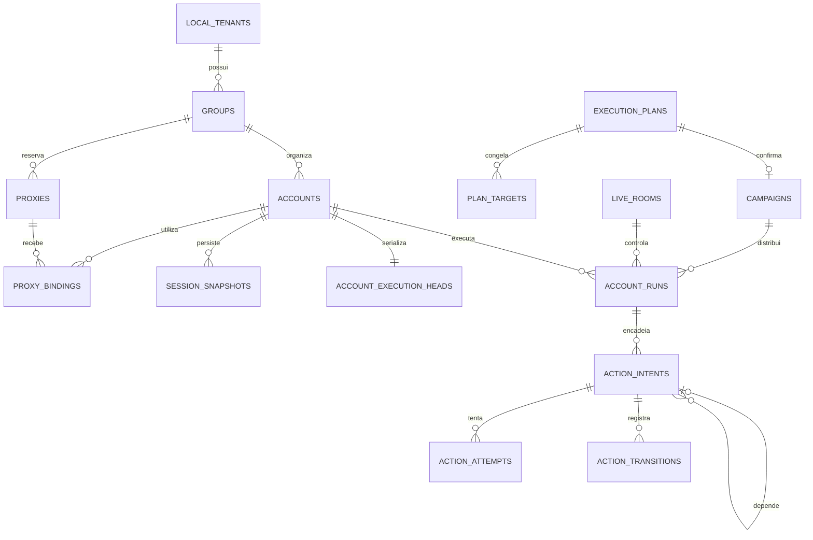

# 2. Modelo de dados e contratos

## 2.1 Convenções e fronteiras

Usar UUIDs opacos, timestamps `timestamptz` em UTC, valores monetários em unidades mínimas inteiras com moeda explícita e `jsonb` somente para parâmetros versionados, políticas e metadados variáveis. Colunas consultadas ou que impõem invariantes devem ser relacionais. A UI converte datas para a timezone escolhida e sempre mostra o fuso na confirmação.

Entidades mutáveis possuem `created_at`, `updated_at` e versão otimista; entidades com exclusão lógica possuem `deleted_at`. Essas colunas comuns podem estar omitidas no dicionário para reduzir repetição. Histórico, versões de política e snapshots são imutáveis.

Toda entidade local pertencente a um cliente possui `tenant_id NOT NULL`. IDs recebidos não substituem autorização. Cada tabela referenciável tem `UNIQUE (tenant_id, id)`; FKs entre tabelas de negócio incluem `tenant_id`. Registros globais, como versões públicas de adaptadores, ficam em schema próprio e não contêm dados de clientes.

Há dois bancos com responsabilidades distintas:

- **Banco local:** contas de sites, segredos cifrados, grupos, sessões, campanhas, filas lógicas, eventos, instalação e espelhos de identidade/licença. É a fonte da verdade operacional daquela instalação.
- **Banco remoto:** usuários do software, credenciais de login próprias, 2FA, organizações, assinatura, direitos, dispositivos, administração e recibos de webhooks. É a fonte da verdade comercial e de identidade.

Não replicar snapshots de sites para o plano remoto. Em um futuro serviço de execução remoto, cada instalação continua com identidade e escopo definidos; transformar o banco local em um banco compartilhado requer revisão de ameaça e implantação.

## 2.2 Entidades do plano remoto

| Tabela | Campos principais | Relações e regras |
| --- | --- | --- |
| `users` | `id`, `email_normalized`, `password_hash`, `email_verified_at`, `status`, `created_at` | Email único; senha do software recebe hash Argon2id, não cifra reversível |
| `user_mfa` | `user_id`, `type`, `secret_ciphertext`, `confirmed_at`, `last_totp_step` | Segredo TOTP cifrado; códigos de recuperação em hashes separados |
| `identity_sessions` | `id`, `user_id`, `refresh_token_hash`, `family_id`, `expires_at`, `revoked_at` | Rotação e detecção de reutilização revogam a família |
| `tenants` | `id`, `name`, `status`, `created_at` | Workspace; suspensão não equivale a excluir dados |
| `memberships` | `tenant_id`, `user_id`, `role`, `status` | `UNIQUE (tenant_id, user_id)`; papéis `owner`, `operator`, `viewer` |
| `platform_admins` | `user_id`, `scope`, `granted_by`, `granted_at` | Papel global separado dos papéis de tenant; 2FA obrigatório |
| `plans` | `id`, `code`, `max_accounts`, `max_live_views`, `feature_flags`, `version` | Limites versionados; edição não reescreve contratos antigos silenciosamente |
| `subscriptions` | `id`, `tenant_id`, `provider_customer_id`, `provider_subscription_id`, `status`, `period_end` | Identificadores do provedor únicos; nenhum dado de cartão |
| `entitlement_grants` | `id`, `tenant_id`, `kind`, `limits`, `valid_from`, `valid_until`, `revoked_at`, `reason` | `kind=subscription`, `perpetual_vip` ou concessão temporária; autor/data de alteração |
| `devices` | `id`, `tenant_id`, `installation_public_key`, `status`, `last_seen_at` | Chave criada na instalação; licença limita dispositivos |
| `entitlement_snapshots` | `id`, `tenant_id`, `device_id`, `revision`, `issued_at`, `expires_at`, `claims`, `signature_key_id` | Documento assinado; limites e identidade de instalação explícitos |
| `billing_events` | `provider`, `event_id`, `received_at`, `processed_at`, `payload_digest` | `UNIQUE (provider, event_id)`; autenticar assinatura e impedir replay |
| `platform_audit` | `actor_id`, `target_tenant_id`, `verb`, `reason`, `request_id`, `created_at` | Histórico de concessões, suspensão, limites e ações administrativas |

VIP permanente é um direito comercial, não um papel administrativo. Um usuário normal pode ter assinatura mensal ou concessão permanente. A política resolve limites por regras explícitas e versionadas; não somar quotas de vários grants por acidente. Um grant permanente elimina renovação de pagamento, mas pode exigir renovação técnica da prova assinada para receber revogações e alterações.

## 2.3 Entidades locais: identidade, grupos e segredos

| Tabela | Campos principais | Relações e invariantes |
| --- | --- | --- |
| `installations` | `id`, `device_id`, `public_key`, `schema_version`, `created_at` | Uma instalação ativa por banco local |
| `local_tenants` | `id`, `name`, `remote_revision`, `status` | Espelho de tenant autenticado pelo plano remoto |
| `local_principals` | `id`, `tenant_id`, `remote_user_id`, `role`, `claims_expires_at` | Sem senha de login remoto no banco local |
| `local_entitlements` | `id`, `tenant_id`, `revision`, `signed_document`, `expires_at`, `verified_at` | Só aceitar documento com assinatura válida e dispositivo correspondente |
| `groups` | `id`, `tenant_id`, `name`, `enabled`, `policy_version_id`, `environment_profile_id`, `version` | Nomes únicos por tenant; mudar grupo de uma conta exige migração controlada |
| `group_policy_versions` | `id`, `tenant_id`, `group_id`, `version`, `window_seconds`, `max_actions_hour`, `max_concurrency`, `policy_json`, `created_by` | Versões imutáveis; política guarda quotas por conta/grupo e comportamento de falha |
| `environment_profiles` | `id`, `tenant_id`, `group_id`, `version`, `browser_revision`, `environment_adapter_version`, `ua`, `timezone`, `locale`, `viewport`, `permissions`, `diagnostic_result` | Perfil e módulo de adaptação fixados no plano; nenhuma promessa de fingerprint exclusivo |
| `site_profiles` | `id`, `tenant_id`, `name`, `start_url`, `navigation_origins`, `resource_policy`, `auth_mode`, `capability_mode`, `integration_id`, `integration_version`, `version` | Configurado pelo cliente; modo genérico independe de integração por domínio; URL e políticas validadas contra SSRF |
| `vault_keys` | `id`, `tenant_id`, `scope`, `group_id`, `version`, `wrapped_key`, `wrapping_key_id`, `status` | DEK aleatória cifrada pela chave raiz; nunca armazenar DEK aberta |
| `secrets` | `id`, `tenant_id`, `group_id`, `owner_kind`, `owner_id`, `purpose`, `ciphertext`, `nonce`, `key_id`, `schema_version` | AEAD com contexto autenticado; acesso mínimo por finalidade |
| `accounts` | `id`, `tenant_id`, `group_id`, `site_id`, `login_ciphertext_ref`, `login_lookup_hmac`, `password_secret_id`, `enabled`, `account_state`, `notes`, `last_activity_at`, `version` | Login completo é sensível; HMAC permite detectar duplicatas sem índice em texto aberto |
| `account_group_assignments` | `id`, `tenant_id`, `account_id`, `group_id`, `valid_from`, `valid_until`, `migration_id` | Histórico imutável de pertencimento; somente uma associação atual por conta |
| `account_status_events` | `id`, `tenant_id`, `account_id`, `old_state`, `new_state`, `reason_code`, `source`, `observed_at`, `evidence_ref` | Histórico append-only, com evidência mínima e sem corpos sensíveis |

`login_lookup_hmac` usa chave exclusiva de indexação por tenant e normalização definida pelo adaptador. Não usar hash simples para emails ou nomes previsíveis. O login completo é entregue apenas ao fluxo autorizado de autenticação; listagens mostram um rótulo mascarado ou alias não sensível.

`accounts.site_id` referencia `site_profiles` por FK composta com tenant. O perfil também é fixado nas receitas, planos, snapshots e salas, diretamente ou pelo run/conta, com versão no plano confirmado. No modo genérico o login pode ser manual e a conta pode começar como um perfil de sessão com alias, sem senha armazenada. Usar unicidade parcial do HMAC apenas quando houver login informado; gerar um ID independente para cada sessão. Alterar URL/origens requer revalidar receitas e não transporta cookies para outra sessão por conveniência.

Notas podem conter informação pessoal: limitar tamanho, cifrar se a política exigir, não indexar em mecanismos externos. Nenhum segredo deve aparecer duplicado dentro de `policy_json` ou parâmetros de ações.

## 2.4 Proxies e sessões

| Tabela | Campos principais | Relações e invariantes |
| --- | --- | --- |
| `proxies` | `id`, `tenant_id`, `owner_group_id`, `scheme`, `host`, `port`, `auth_secret_id`, `max_accounts`, `state`, `observed_egress_ip`, `version` | Porta válida; limite positivo; proxy estrito pertence a um grupo |
| `proxy_bindings` | `id`, `tenant_id`, `group_id`, `proxy_id`, `account_id`, `bound_at`, `released_at`, `route_version` | Um vínculo atual por conta; grupo do proxy e da conta devem coincidir |
| `proxy_checks` | `id`, `tenant_id`, `proxy_id`, `checked_at`, `latency_ms`, `result`, `error_code`, `egress_ip` | Retenção curta; nunca incluir URL com usuário/senha |
| `session_snapshots` | `id`, `tenant_id`, `group_id`, `account_id`, `revision`, `encrypted_blob`, `key_id`, `nonce`, `adapter_version`, `route_version`, `saved_at`, `auth_verified_at`, `expires_hint_at` | Revisões imutáveis; snapshot atual apontado na conta/runtime |
| `account_runtime` | `tenant_id`, `account_id`, `snapshot_id`, `auth_state`, `runtime_state`, `last_health_at`, `health_due_at`, `state_version` | PK por conta; estado operacional não é a identidade comercial da conta |
| `session_leases` | `tenant_id`, `account_id`, `owner_id`, `owner_kind`, `epoch`, `expires_at`, `last_heartbeat_at`, `fenced_at` | PK por conta; época crescente; não reutilizar owner após failover |
| `workers` | `id`, `tenant_id`, `group_id`, `generation`, `state`, `last_seen_at`, `memory_bytes`, `context_count`, `supervisor_id` | Runner associado a um único grupo durante sua vida |
| `health_checks` | `id`, `tenant_id`, `account_id`, `scheduled_at`, `checked_at`, `result`, `confidence`, `transport_error`, `evidence_code` | Resultado desconhecido é explícito; atualização de status só com regra do adaptador |

Aplicar FKs compostas `(tenant_id, group_id, id)` nas entidades de grupo que tenham identidade estável. Registros históricos de ação, snapshot, segredo e vínculo de proxy também referenciam `group_assignment_id`, fixando o grupo válido naquele momento. Não criar uma FK histórica que dependa de `accounts.group_id` mutável, pois trocar de grupo quebraria o histórico. A associação atual da conta é atualizada em transação; chaves, proxies e snapshots anteriores continuam associados à versão antiga. Migrar recifra/revalida o estado atual conforme necessário, preserva evidências antigas e invalida planos pendentes afetados. Capacidade de proxy é garantida por operação transacional, não por restrição declarativa de soma.

Estados separados:

- `account_state`: `ACTIVE`, `BLOCKED`, `BANNED`, `MAINTENANCE`, `LOGIN_ERROR`, `UNKNOWN`.
- `auth_state`: `VALID`, `EXPIRED`, `ABSENT`, `CHALLENGE_REQUIRED`, `UNKNOWN`.
- `runtime_state`: `DORMANT`, `RESTORING`, `LIVE`, `AUTOMATING`, `CHECKING`, `STOPPING`, `ERROR`.
- `enabled`: escolha do usuário; desabilitar impede novos efeitos, sem apagar histórico.

A UI calcula “Desconectada” a partir de `auth_state=EXPIRED/ABSENT`, “Ativa” a partir de conta elegível com sessão válida e “Banida” apenas de evidência correspondente. Uma conta pode estar ativa com contexto dormente; não confundir os dois conceitos.

## 2.5 Planejamento, execução e espelhamento

| Tabela | Campos principais | Relações e invariantes |
| --- | --- | --- |
| `recipes` | `id`, `tenant_id`, `name`, `current_version_id` | Modelo reutilizável sem credenciais |
| `recipe_versions` | `id`, `tenant_id`, `recipe_id`, `version`, `adapter_version`, `steps_json`, `created_by` | Passos semânticos versionados e imutáveis |
| `execution_plans` | `id`, `tenant_id`, `created_by`, `recipe_version_id`, `mode`, `starts_at`, `deadline`, `seed`, `canonical_hash`, `expires_at`, `resource_revision` | Snapshot imutável da simulação |
| `plan_targets` | `tenant_id`, `plan_id`, `account_id`, `eligibility`, `reason`, `account_version`, `policy_version`, `route_version`, `schedule_json` | Materialização das contas, inclusive exclusões explicadas |
| `plan_confirmations` | `id`, `tenant_id`, `plan_id`, `actor_id`, `token_hash`, `expires_at`, `consumed_at`, `campaign_id` | Token opaco de uso único; consumo e campanha na mesma transação |
| `campaigns` | `id`, `tenant_id`, `plan_id`, `state`, `mode`, `started_at`, `deadline`, `cancel_requested_at`, `created_by`, `version` | Uma campanha por confirmação; contadores derivados ou reconciliáveis |
| `account_runs` | `id`, `tenant_id`, `account_id`, `campaign_id`, `live_room_id`, `recipe_version_id`, `state`, `baseline_revision` | Execução da receita para uma conta; origem exatamente uma: campanha ou sala |
| `action_intents` | `id`, `tenant_id`, `group_id`, `account_id`, `account_run_id`, `step_no`, `depends_on_id`, `previous_execution_id`, `execution_epoch`, `dispatch_seq`, `action_type`, `params_json`, `state`, `version`, `earliest_start`, `latest_start`, `deadline`, `adapter_version`, `idempotency_key`, `lease_owner_id`, `lease_expires_at`, `cancel_requested_at` | Intenção única por run/passo; dependência da receita e ordem global são verificadas separadamente |
| `action_attempts` | `id`, `tenant_id`, `action_id`, `attempt_no`, `worker_id`, `lease_epoch`, `started_at`, `effect_sent_at`, `finished_at`, `outcome`, `error_code`, `receipt_ref` | Registrar intenção de efeito antes de enviar; recibo posterior sem apagar tentativas anteriores |
| `action_transitions` | `id`, `tenant_id`, `action_id`, `from_state`, `to_state`, `action_version`, `reason`, `actor_id`, `created_at` | Append-only, `UNIQUE (tenant_id, action_id, action_version)` |
| `account_execution_heads` | `tenant_id`, `account_id`, `execution_epoch`, `next_dispatch_seq`, `current_action_id`, `last_execution_id`, `last_succeeded_id`, `blocked_reason`, `version` | Linha única serializa todos os canais de execução da conta |
| `quota_reservations` | `id`, `tenant_id`, `scope_kind`, `scope_id`, `action_id`, `reserved_at`, `expires_at`, `committed_at`, `units` | Quotas duráveis compartilhadas por execução manual, espelhamento e campanha |
| `quota_scopes` | `tenant_id`, `scope_kind`, `scope_id`, `policy_version`, `version` | Linha de coordenação bloqueada antes de contar/reservar unidades na janela móvel; evita corrida entre reservas concorrentes |
| `live_rooms` | `id`, `tenant_id`, `leader_account_id`, `membership_version`, `state`, `mirror_enabled`, `failure_policy`, `created_by` | Um líder; no máximo quatro membros |
| `live_room_members` | `tenant_id`, `room_id`, `account_id`, `position`, `joined_at`, `left_at`, `last_command_seq` | `UNIQUE` por posição atual e conta atual; uma sala controladora por conta |
| `live_commands` | `id`, `tenant_id`, `room_id`, `membership_version`, `command_seq`, `actor_id`, `semantic_payload`, `created_at` | ID do cliente deduplicado; fan-out cria intenções por participante |

`account_runs` não mistura duas origens. Uma restrição XOR exige exatamente um de `campaign_id` e `live_room_id`. Campanha e sala são agregadores; o estado definitivo permanece por ação e conta. Campanha pode terminar `PARTIAL` se houver mistura de sucessos, falhas e cancelamentos; o usuário recebe contagens por resultado.

### Duas ordens complementares

1. **Dependência da receita:** `step_no` e `depends_on_id` são definidos no planejamento. O passo B da receita depende do sucesso do passo A da mesma conta.
2. **Sequência de execução da conta:** `dispatch_seq` e `previous_execution_id` são atribuídos apenas quando o próximo efeito é admitido, sob lock de `account_execution_heads`. O predecessor global deve ter sucesso confirmado ou a conta deve estar em uma nova época com baseline validado.

Assim, ações futuras planejadas não bloqueiam a abertura de um painel antes de começarem. Ao assumir controle ao vivo, pausar a admissão das campanhas daquela conta. Receita já iniciada deve terminar sua unidade segura; só permitir pausa entre passos se o adaptador declarar suporte e revalidar o baseline antes da retomada. Uma interação manual que invalide pré-condições pausa a receita e requer revisão do restante. A regra de uma ação de cada vez continua global.

Não ordenar efeitos pela ordem de chegada do BullMQ ou pela ordem de criação de linhas. Campanhas prontas usam FIFO por conta e justiça entre grupos; posse ao vivo é explícita e auditada, adquirida somente numa fronteira segura.

## 2.6 Eventos, auditoria, importação e backup

| Tabela | Campos principais | Relações e regras |
| --- | --- | --- |
| `outbox_events` | `id`, `tenant_id`, `topic`, `aggregate_id`, `aggregate_version`, `payload`, `created_at`, `published_at`, `publish_attempts` | Publicação repetível; payload sem segredo |
| `tenant_events` | `tenant_id`, `sequence`, `type`, `entity_id`, `entity_version`, `payload`, `created_at` | Cursor durável monotônico por tenant, atribuído por contador transacional |
| `tenant_event_counters` | `tenant_id`, `next_sequence` | Contador bloqueado na transação que publica eventos; garante sequência compatível com commit |
| `audit_log` | `id`, `tenant_id`, `actor_id`, `verb`, `target_kind`, `target_id`, `request_id`, `reason`, `redacted_diff`, `created_at` | Append-only para papéis normais; retenção maior que eventos de UI |
| `idempotency_records` | `tenant_id`, `actor_id`, `route`, `key`, `request_hash`, `response_ref`, `created_at`, `expires_at` | Mesmo token com payload diferente retorna conflito |
| `imports` | `id`, `tenant_id`, `source_kind`, `state`, `row_count`, `valid_count`, `error_count`, `created_by` | Preview e commit separados; conteúdo aberto só durante processamento |
| `import_rows` | `id`, `tenant_id`, `import_id`, `row_number`, `normalized_encrypted_data`, `validation_errors`, `committed_account_id` | Limpar staging após commit/expiração; nunca persistir senha aberta |
| `exports` | `id`, `tenant_id`, `kind`, `filter_snapshot`, `state`, `artifact_ref`, `expires_at`, `created_by` | CSV de status/histórico sem senha, cookie ou segredo de proxy |
| `backups` | `id`, `tenant_id`, `format_version`, `schema_version`, `snapshot_revision`, `manifest_digest`, `artifact_ref`, `state`, `verified_at` | Backup portátil cifrado e com teste de integridade |
| `restore_runs` | `id`, `tenant_id`, `backup_id`, `state`, `conflict_policy`, `validation_report`, `started_at`, `finished_at` | Restauração em staging; jobs não voltam a executar automaticamente |

Para cursor de UI, incrementar contador do tenant dentro da transação; uma sequência SQL global isolada pode expor números fora da ordem de commit. Ao consumir eventos concorrentes, garantir visibilidade em ordem ou exigir snapshot/replay com contrato adequado. ID de evento e versão de agregado permitem deduplicar na UI.

Auditoria local append-only protege contra erros de aplicação, mas não contra o administrador do host. Evidência resistente a adulteração exige cópia assinada/encadeada para destino remoto com retenção independente e sem segredos, opcional por contrato empresarial.

## 2.7 Relações principais



Os nomes do diagrama são entidades conceituais; todas as relações de negócio são também limitadas pelo tenant. Não permitir `ON DELETE CASCADE` apagar histórico operacional sem política de retenção explícita. Exclusão normal é lógica; purga remove/cifra dados conforme retenção e obrigações do produto.

## 2.8 Restrições, índices e RLS

Índices prioritários:

```sql
-- Trechos ilustrativos para as futuras migrations; não são um schema completo.
CREATE UNIQUE INDEX accounts_login_uniq
  ON accounts (tenant_id, site_id, login_lookup_hmac)
  WHERE deleted_at IS NULL;

CREATE UNIQUE INDEX current_proxy_per_account
  ON proxy_bindings (tenant_id, account_id)
  WHERE released_at IS NULL;

CREATE UNIQUE INDEX action_per_recipe_step
  ON action_intents (tenant_id, account_run_id, step_no);

CREATE UNIQUE INDEX account_dispatch_order
  ON action_intents (tenant_id, account_id, execution_epoch, dispatch_seq)
  WHERE dispatch_seq IS NOT NULL;

CREATE UNIQUE INDEX one_unresolved_action_per_account
  ON action_intents (tenant_id, account_id)
  WHERE state IN ('LEASED', 'RUNNING', 'VERIFYING', 'RECONCILING', 'UNKNOWN');

CREATE INDEX due_actions
  ON action_intents (earliest_start, tenant_id, group_id)
  WHERE state = 'SCHEDULED';

CREATE INDEX pending_outbox
  ON outbox_events (created_at, id)
  WHERE published_at IS NULL;

CREATE INDEX account_status_filter
  ON accounts (tenant_id, account_state, enabled, group_id, id);

CREATE INDEX account_history
  ON action_intents (tenant_id, account_id, created_at DESC, id);

CREATE INDEX due_health
  ON account_runtime (health_due_at, tenant_id, account_id);

CREATE UNIQUE INDEX event_cursor
  ON tenant_events (tenant_id, sequence);
```

Aplicar PK/FKs antes desses índices. `depends_on_id` e `previous_execution_id` usam FKs compostas que comprovam tenant e conta iguais; o predecessor da receita pertence ao run correto e tem passo menor. Essa ordem precisa de validação transacional/trigger, pois FK não comprova precedência nem sucesso. Proibir ciclos na escrita e manter receitas imutáveis após confirmação.

Exemplo de política para uma tabela:

```sql
ALTER TABLE accounts ENABLE ROW LEVEL SECURITY;
ALTER TABLE accounts FORCE ROW LEVEL SECURITY;

CREATE POLICY tenant_boundary ON accounts
  USING (tenant_id = nullif(current_setting('app.tenant_id', true), '')::uuid)
  WITH CHECK (tenant_id = nullif(current_setting('app.tenant_id', true), '')::uuid);
```

No começo de cada transação, a API executa `SELECT set_config('app.tenant_id', $1, true)` com tenant obtido da sessão autenticada. Não aceitar essa escolha em body, query string ou ticket não autenticado. O ajuste é local à transação para evitar vazamento entre conexões do pool.

Papéis da aplicação não são superuser, não possuem `BYPASSRLS`, não são proprietários e não têm `TRUNCATE`, DDL ou possibilidade de `SET ROLE` privilegiado. Migrations e backups usam papéis separados. **RLS não protege contra um backend comprometido que possa escolher livremente o tenant da transação**; ela complementa autorização, FKs e capacidades de serviço. Referência: [limites e comportamento de Row Security no PostgreSQL](https://www.postgresql.org/docs/current/ddl-rowsecurity.html).

Runners não recebem credencial PostgreSQL. Consomem um gateway com token temporário limitado a tenant/grupo/conta/ação e operação. O coordenador tem papel operacional, não papel de migração. Para deployments com maior exigência, dividir papéis e bancos por tenant.

## 2.9 Transações essenciais

### Confirmar plano

```text
BEGIN
  bloquear confirmação e validar usuário, hash, validade e uso único
  bloquear/ler versões relevantes e verificar entitlement assinado
  revalidar capacidade contratual, contas, políticas e rotas
  criar campanha e runs, ações planejadas e suas dependências
  consumir token e registrar chave de idempotência + campanha resultante
  gravar auditoria, eventos e outbox
COMMIT
```

Ações iniciais só entram em admissão quando horário, recursos e dependências permitirem. Uma alteração concorrente de proxy ou política usa o mesmo controle de versão/lock e invalida o plano, em vez de ocorrer entre validação e commit. Não há chamada ao site dentro dessa transação.

### Admitir o próximo efeito de uma conta

```text
BEGIN
  obter lock de account_execution_heads com FOR UPDATE
  verificar ausência de ação atual não resolvida e de bloqueio
  verificar origem autorizada pela concessão de sessão
  validar predecessor da receita e último efeito global = SUCCEEDED
  validar baseline, enabled, status, deadline e versão de rota
  reservar quotas de conta/grupo/proxy em ordem de lock estável
  atribuir execution_epoch, dispatch_seq e previous_execution_id
  atribuir lease de ação e época de sessão, avançar versão
  transicionar READY → LEASED, gravar tentativa e outbox
COMMIT
  enviar comando ao runner por capacidade temporária
```

Nunca segurar lock SQL durante operação de rede ou navegação. `SKIP LOCKED` distribui candidatos, mas o lock da conta e as checagens continuam obrigatórios. Reservas de quota têm prazo curto; se o efeito não começou, liberá-las com evidência. Contar separadamente ações de negócio e requisições técnicas; uma ação pode gerar várias requisições.

Retry da mesma ação é uma exceção à checagem de ausência de ação atual: a cabeça pode apontar para **essa mesma** ação em `RETRY_WAIT`. Ela preserva `dispatch_seq`, predecessor e chave de idempotência, incrementa apenas a tentativa e recebe novo lease. Enquanto espera retry, a conta não admite outra intenção. Para quotas, bloquear as linhas de `quota_scopes` em ordem canônica, contar reservas válidas na janela e então inserir a reserva; somente consultar e inserir sem lock não impede ultrapassar o limite.

Antes do efeito, runner confirma lease e grava que o envio vai começar; após isso, crash significa resultado potencialmente incerto. Não tratar ausência de `effect_sent_at` isoladamente como prova de ausência de envio: há uma janela entre registrar e enviar, e o código/protocolo precisa considerar essa fronteira de forma conservadora.

### Confirmar sucesso

```text
BEGIN
  validar owner, época e versão atuais
  registrar recibo/pós-condição e concluir tentativa
  transicionar ação para SUCCEEDED
  atualizar último sucesso e liberar ação atual da conta
  persistir checkpoint de autenticação se ele mudou
  tornar próximo passo da receita elegível para agendamento
  gravar eventos e outbox
COMMIT
```

Se o commit falha depois do sucesso externo, o retry do consumidor primeiro reconcilia. Um resultado de owner antigo é evidência para análise; não pode sobrescrever automaticamente a época nova. Recursos operacionais só são liberados quando o estado da sessão e a possibilidade de efeitos em voo estiverem resolvidos.

Reset autorizado de uma cadeia ocorre em transação separada, depois das provas de fencing e fronteira segura: bloquear a cabeça da conta, registrar evidência e motivo, mover ação incerta para `ABANDONED` quando aplicável, cancelar sucessoras antigas, encerrar o run, criar nova época/baseline e limpar ponteiros de execução da época anterior. O índice de ação não resolvida deixa de incluir a ação abandonada, mas o resultado desconhecido permanece nas tentativas e auditoria. Ações da época antiga não podem ser readmitidas. O reset não executa nova receita; ela passa pelo fluxo normal de confirmação.

## 2.10 Contratos da API local

Prefixo `/v1`, schemas compartilhados e OpenAPI gerada. Autenticação da instalação e usuário são distintas: um processo pareado não ganha automaticamente acesso a qualquer tenant. Sem exposição de SQL, filesystem, CDP, código de adaptadores ou Docker na API de produto.

| Método e rota | Finalidade | Garantia importante |
| --- | --- | --- |
| `GET /status` | Liveness mínimo | Sem nomes de conta, versões sensíveis ou credenciais |
| `GET /ready` | Prontidão autenticada | Banco, Redis, migração, cofre e entitlement separados |
| `GET /accounts` | Busca, filtros e paginação por cursor | Campos mascarados, escopo por tenant |
| `POST /accounts` | Cadastro individual | Quota em transação; segredo cifrado na entrada |
| `PATCH /accounts/:id` | Editar/ativar/desativar | `If-Match` obrigatório; parar novos efeitos ao desativar |
| `DELETE /accounts/:id` | Exclusão lógica confirmada | Conflito se ação/sessão não resolvida; auditoria |
| `POST /imports/preview` | CSV ou texto colado | Parser com limites, staging cifrado e erros por linha |
| `POST /imports/:id/commit` | Importar linhas aprovadas | Revalidar quotas e duplicatas atomicamente |
| `GET/POST/PATCH /site-profiles` | Sites escolhidos pelo cliente e suas capacidades | Validar URL/origens, tenant, versão e impactos nas receitas; sem sondar destinos internos |
| `GET/POST/PATCH /groups` | Grupos e políticas | Alterações criam versão; exclusão exige migração de contas |
| `POST /proxies/import` | Importar proxies | Validação de destino e credenciais cifradas |
| `POST /proxies/:id/test` | Teste diagnóstico | Egress obrigatório; rate limit; resultado assíncrono |
| `POST /proxies/assignment-plans` | Simular distribuição | Mostra capacidade e movimentos de contas |
| `POST /proxies/assignment-plans/:id/confirm` | Aplicar distribuição/rotação | Fronteira segura e versões válidas |
| `POST /accounts/:id/check` | Diagnóstico explicitamente solicitado | Usa coordenação da sessão e respeita budgets |
| `POST /plans/simulate` | Criar dry-run imutável | Nenhum efeito no site ou teste de proxy |
| `GET /plans/:id` | Consultar simulação | Mostra hash, validade, exclusões e limites |
| `POST /plans/:id/confirm` | Iniciar campanha | Token único + `Idempotency-Key` + hash exato |
| `GET /campaigns/:id` | Acompanhamento | Contagens por estado e motivos por conta |
| `POST /campaigns/:id/cancel` | Cancelamento em lote | Persistir intenção; não prometer desfazer efeitos |
| `POST /actions/:id/cancel` | Cancelar ação | Semântica dependente do estado |
| `POST /actions/:id/reconcile` | Revisar resultado incerto | Operação autorizada, auditada e baseada em evidência |
| `POST /actions/:id/retry` | Retry explícito | Mesmo efeito lógico; somente se replay é seguro |
| `POST /accounts/:id/reset-execution` | Abandonar cadeia e validar baseline novo | Fencing, ausência de efeito em voo, reautenticação/confirmação forte, motivo e auditoria |
| `POST /live-rooms` | Abrir 1–4 painéis | Slots e concessões antes de afirmar prontidão |
| `PATCH /live-rooms/:id` | Alterar líder/membros/espelhamento | Versão e barreira de comandos em voo |
| `POST /live-rooms/:id/commands` | Input durável | ID estável; parâmetros semânticos validados |
| `DELETE /live-rooms/:id` | Encerrar sala | Captura para; efeitos em voo são reconciliados |
| `GET /events?after=...` | Replay paginado | Cursor do tenant e expiração explícita |
| `WS /control`, `WS /frames` | Eventos/input e mídia separados | Autenticados, limites e capacidades específicas |
| `POST /exports` | CSV assíncrono de status/histórico | Sem segredos; neutralizar fórmulas de planilha |
| `POST /backups` | Gerar backup cifrado | Passphrase não persistida; artefato com prazo |
| `POST /restores/validate` | Validar backup em staging | Nenhuma execução real restaurada |
| `POST /restores/:id/confirm` | Aplicar restauração revisada | Restore point, cofre desbloqueado e conflitos explícitos |

A API remota tem rotas próprias de login, MFA, refresh, dispositivos, licença e painel administrativo. Não incluir o painel global como endpoint privilegiado do backend local.

Respostas de erro:

```json
{
  "error": {
    "code": "PLAN_STALE",
    "message": "O proxy de 3 contas mudou. Gere uma nova simulação.",
    "retryable": false,
    "requestId": "req_opaque_id",
    "details": { "changedTargets": 3 }
  }
}
```

`409` para conflito/versão/posse, `422` para plano inviável, `429` para admissão limitada e `503` para dependência indisponível. `202` significa solicitação persistida, não efeito concluído. Erros não revelam stack, senha ou a existência de recurso pertencente a outro tenant.

## 2.11 Tipos compartilhados e adaptadores

Exemplo orientador, a ser refinado na fase 0:

```ts
type EffectKind = 'read' | 'idempotent' | 'non_idempotent';

interface ActionSpec {
  type: string;
  schemaVersion: number;
  effect: EffectKind;
  params: Record<string, unknown>; // validado pelo schema da ação
  adapterVersion: string;
  expectedBaselineRevision: string;
}

type Verification =
  | { status: 'succeeded'; evidenceCode: string; receiptId?: string }
  | { status: 'absent'; evidenceCode: string; safeToReplay: boolean }
  | { status: 'failed'; evidenceCode: string }
  | { status: 'unknown'; reason: string };

interface SiteAdapter {
  readonly version: string;
  readonly capabilities: {
    lightweightHealth: boolean;
    snapshotAuth: boolean;
    semanticMirror: boolean;
    safePauseBetweenSteps: boolean;
  };
  inspectSession(ctx: AccountContext, signal: AbortSignal): Promise<SessionEvidence>;
  resolveInput(ctx: AccountContext, input: UserInput): Promise<ResolvedIntent>;
  precondition(ctx: AccountContext, spec: ActionSpec): Promise<Precondition>;
  execute(ctx: AccountContext, spec: ActionSpec, signal: AbortSignal): Promise<EffectReceipt>;
  verify(ctx: AccountContext, spec: ActionSpec, receipt?: EffectReceipt): Promise<Verification>;
  reconcile(ctx: AccountContext, spec: ActionSpec, attempt: AttemptEvidence): Promise<Verification>;
}
```

`AccountContext` é uma capacidade opaca criada pelo runner, limitada à conta, à rota e ao lease. Não é uma conexão ao banco nem um conjunto de senhas. `AbortSignal` interrompe espera local quando possível; não desfaz efeito externo. `resolveInput` inspeciona o contexto sem produzir mutação.

Evento durável:

```json
{
  "schemaVersion": 1,
  "eventId": "uuid",
  "sequence": 1842,
  "type": "action.state_changed",
  "occurredAt": "2026-11-04T14:03:12.000Z",
  "entityId": "uuid",
  "entityVersion": 8,
  "correlationId": "uuid",
  "payload": {
    "accountId": "uuid",
    "campaignId": "uuid",
    "state": "VERIFYING",
    "attempt": 1
  }
}
```

Tenant é derivado do canal autenticado e também validado internamente. Mensagens usam limite de tamanho, rate limit e validação de versão. O renderer ignora versões antigas por agregado e recupera lacunas pelo cursor.

## 2.12 Retenção e evolução

Política inicial configurável: eventos de UI por 7 dias, diagnósticos de proxy/health por 30 dias, tentativas e ações detalhadas por 90 dias, auditoria por 365 dias e agregados por 13 meses. Esses prazos são escolhas de produto, sujeitos ao contrato e à política de privacidade, não exigências legais presumidas. Snapshots guardam a versão atual e poucas anteriores cifradas; staging de importação expira em uma hora.

Para 500 contas com duas ações por hora durante oito horas/dia, são cerca de 240 mil ações/mês, antes de tentativas e eventos. Recalcular armazenamento com frequência real e tamanho medido. Particionar histórico por mês quando volume, VACUUM e consultas justificarem; 500 contas, isoladamente, não exigem sharding.

Migrations versionadas usam expansão → migração de dados → contração. Jobs guardam versões de schema e adaptador. Durante atualização, manter compatibilidade N/N−1 nos contratos necessários, drenar trabalhos incompatíveis e nunca executar uma receita antiga com comportamento novo silenciosamente.
